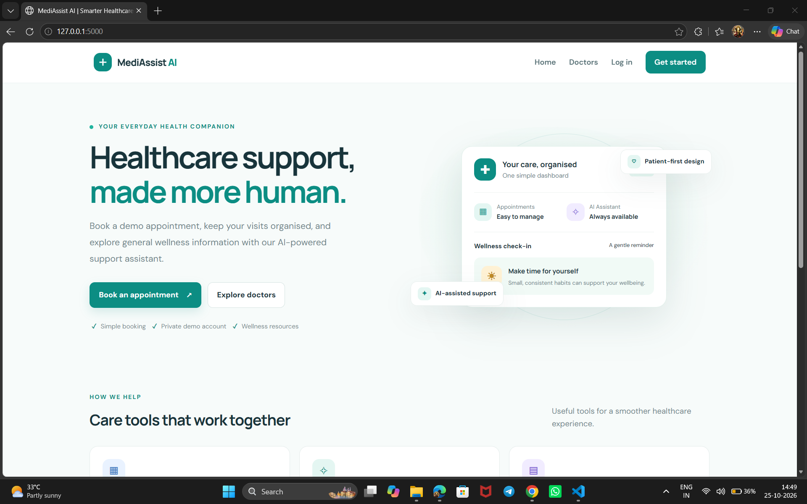
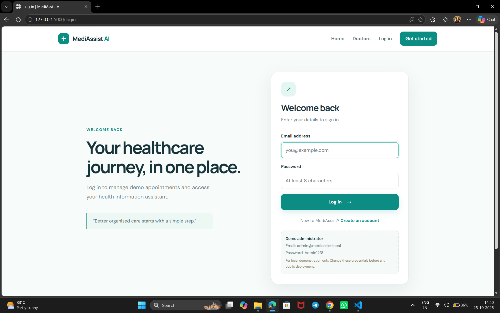
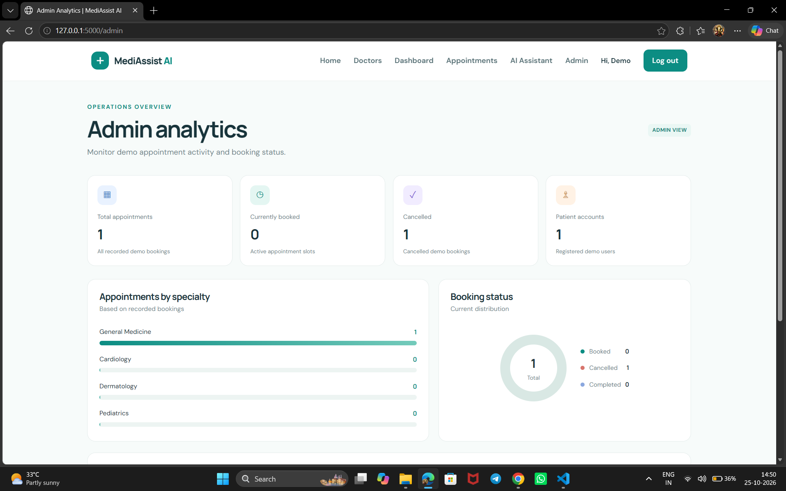
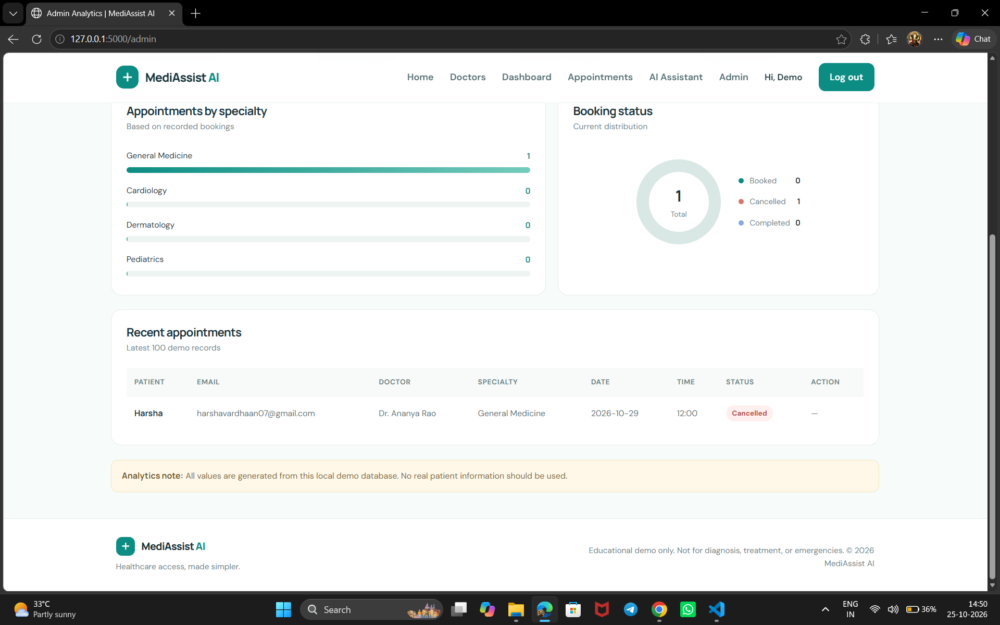
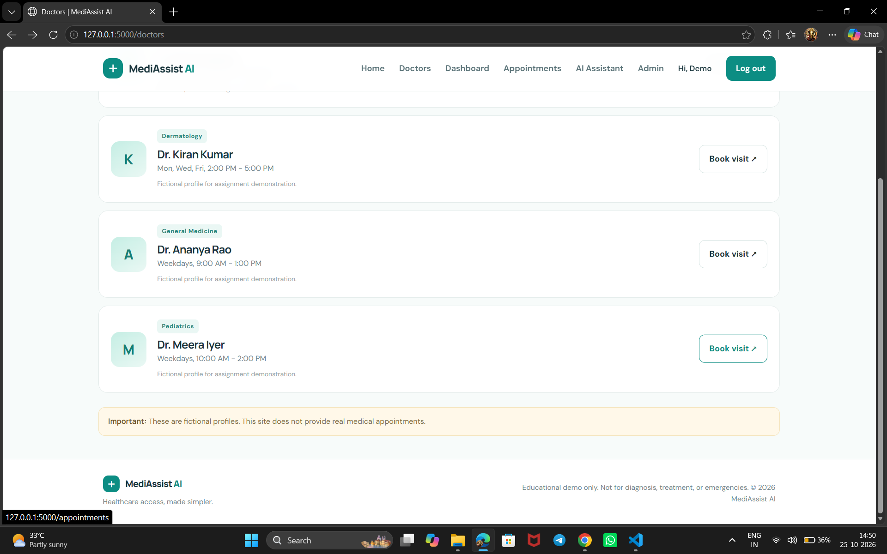
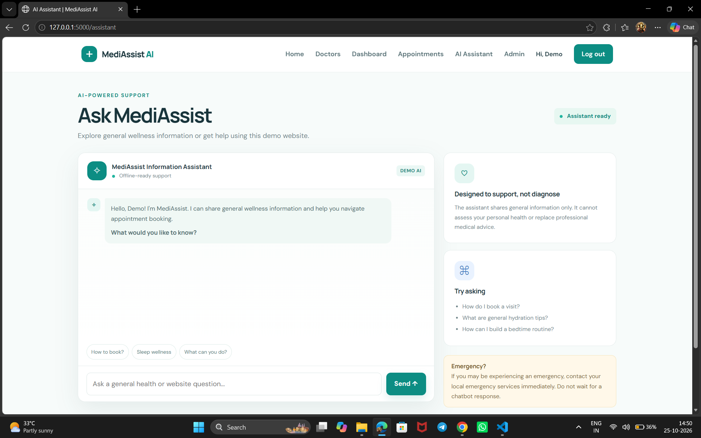
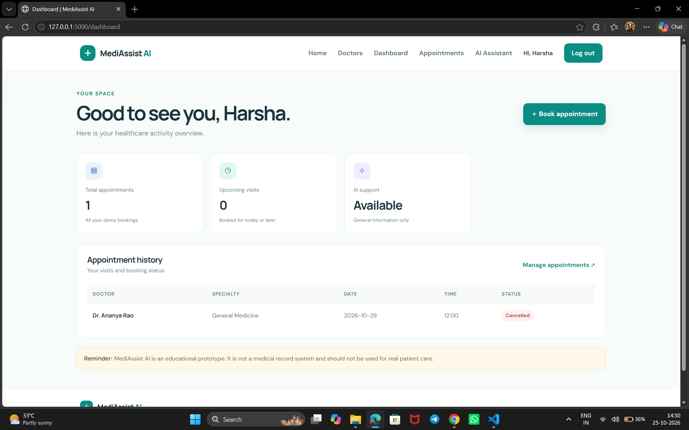
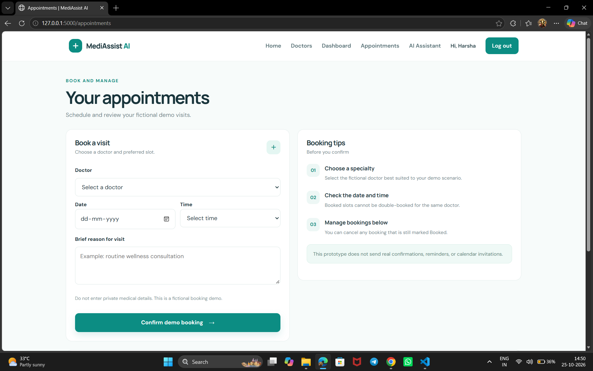
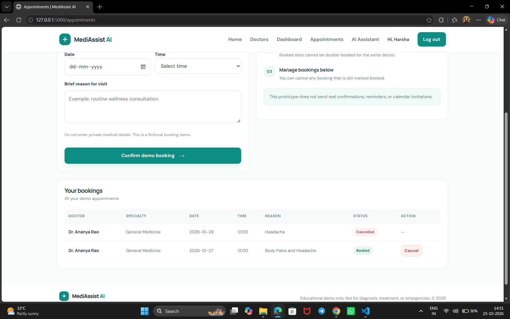

# MediAssist AI — Smarter Healthcare Experience

MediAssist AI is a healthcare website prototype designed to help users explore fictional doctor profiles, manage demo appointments, and access general wellness information through an AI-assistant interface.

> **Educational demo only.** MediAssist AI is not a medical device or a real patient-record system. It does not diagnose or treat medical conditions, and it is not an emergency service. Doctor profiles and appointment workflows are fictional. Do not enter real patient information.

## Features

- Responsive landing page introducing MediAssist AI.
- Login and registration interface for demonstrating the user journey.
- Doctor directory with fictional doctor profiles and specialties.
- Demo appointment booking, viewing, and cancellation.
- Patient dashboard summarizing demo appointment activity.
- Admin analytics dashboard showing appointment counts, statuses, and specialty summaries.
- AI assistant interface for general wellness and website-navigation questions.
- Safety notices that explain the prototype's limitations.

## Screenshots

### Home page


### Login page


### Admin analytics


### Admin analytics — details


### Doctors directory


### AI assistant


### Patient dashboard


### Appointment booking


### Appointment history


## Technology

Update this section to reflect the exact implementation in the repository.

- **Backend:** Python / Flask, if used by this version.
- **Frontend:** HTML, CSS, and JavaScript.
- **Data storage:** Local demo database, if enabled.
- **AI assistant:** Document the implementation actually connected to the app (for example, rule-based offline responses or a configured model endpoint). Do not claim that a hosted large language model is connected unless it has been tested on the deployed website.

## Run locally

1. Clone the repository:

   ```bash
   git clone https://github.com/HarshaVardhanVukkum/MediAssist-AI.git
   cd MediAssist-AI
   ```

2. Create and activate a virtual environment.

   **Windows PowerShell**
   ```powershell
   py -m venv .venv
   .\.venv\Scripts\Activate.ps1
   ```

   **macOS / Linux**
   ```bash
   python3 -m venv .venv
   source .venv/bin/activate
   ```

3. Install dependencies (if your project contains `requirements.txt`):

   ```bash
   pip install -r requirements.txt
   ```

4. Start the application using the command for your project. For a typical Flask app with `app.py`:

   ```bash
   python app.py
   ```

5. Open the local URL printed by the server, commonly `http://127.0.0.1:5000`.

## Deployment notes

For a typical Flask application on Render, the build command is often:

```bash
pip install -r requirements.txt
```

The start command may be:

```bash
gunicorn app:app
```

This assumes the Flask application instance is named `app` inside `app.py` and that `gunicorn` is listed in `requirements.txt`. Confirm these commands against the actual source before deploying.

Set required API keys and service URLs through Render environment variables. Never commit secrets, `.env` files, passwords, or access tokens. Ollama running on a personal computer is not automatically accessible to a hosted Render service.

## Safety and privacy

- This project is a prototype for demonstration and learning.
- Do not use it to make medical decisions or delay professional care.
- Do not enter or upload real patient records or sensitive health information.
- AI responses can be inaccurate and should not replace a qualified healthcare professional.
- Real-world use would require professional review of authentication, authorization, privacy, security, clinical safety, data retention, and applicable regulatory requirements.

## Project owner

**Harsha Vardhan**  
GitHub: [HarshaVardhanVukkum](https://github.com/HarshaVardhanVukkum)

## License

No license is specified yet. Unless a license is added to this repository, others should not assume they have permission to reuse or redistribute the code.
